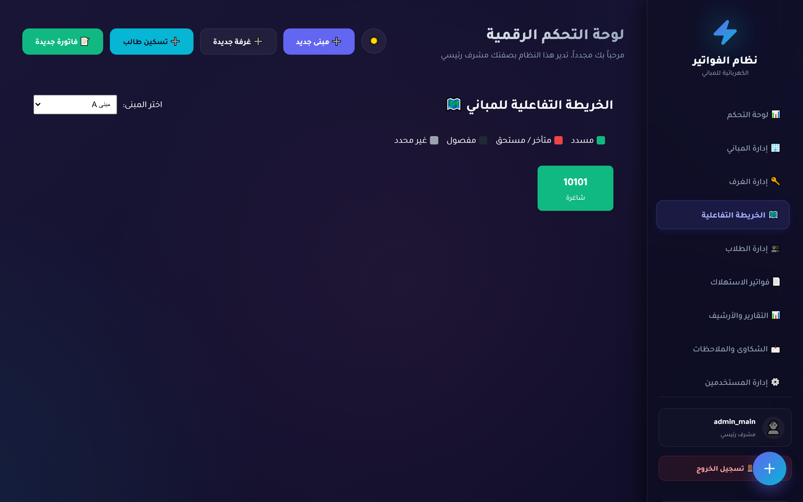
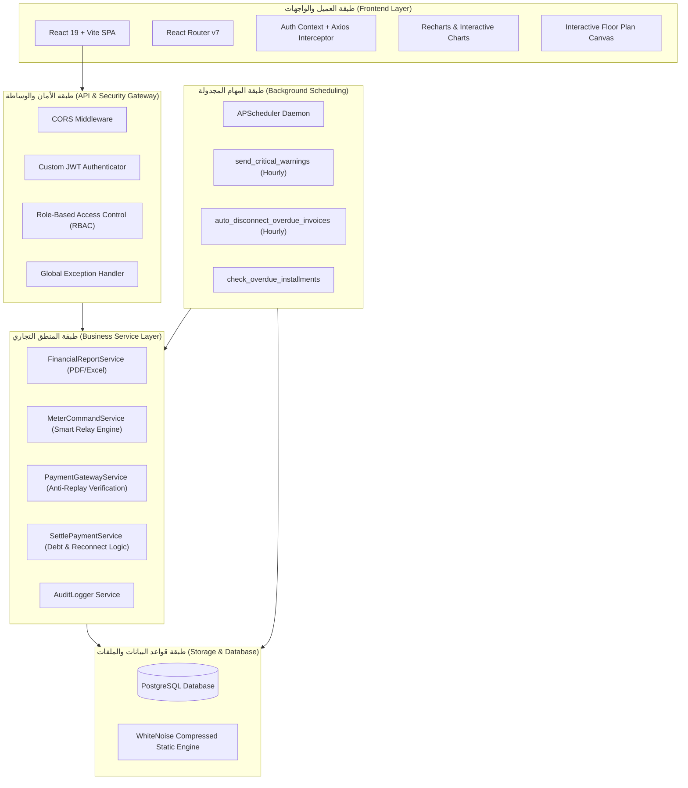
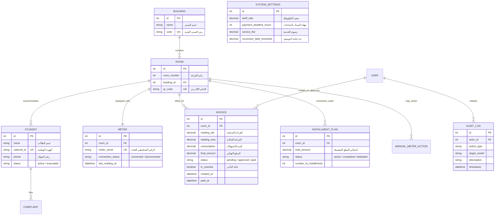
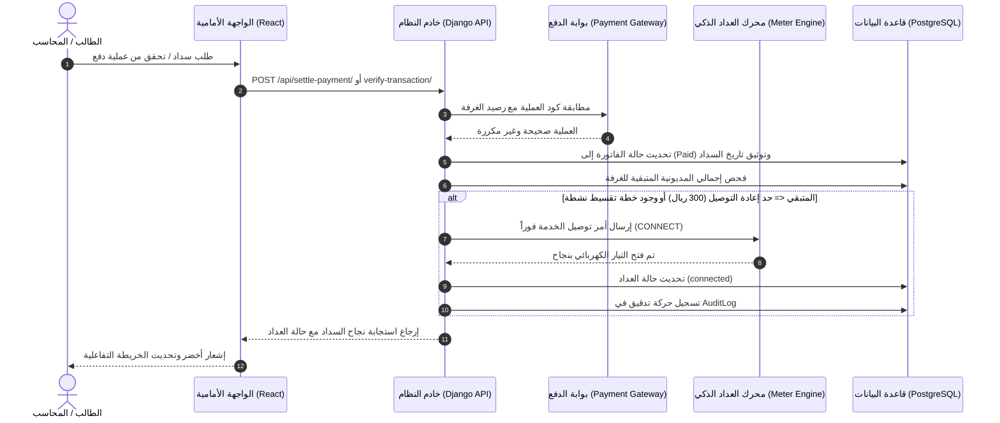
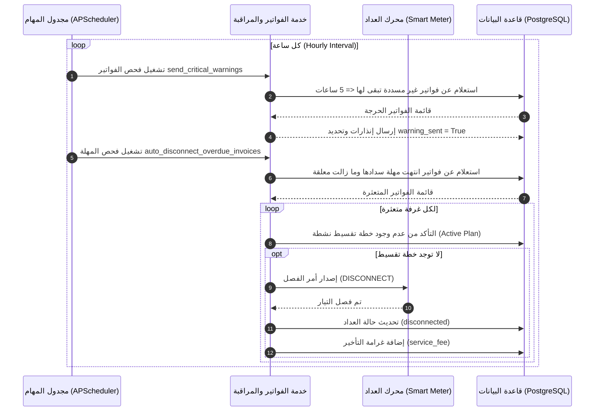
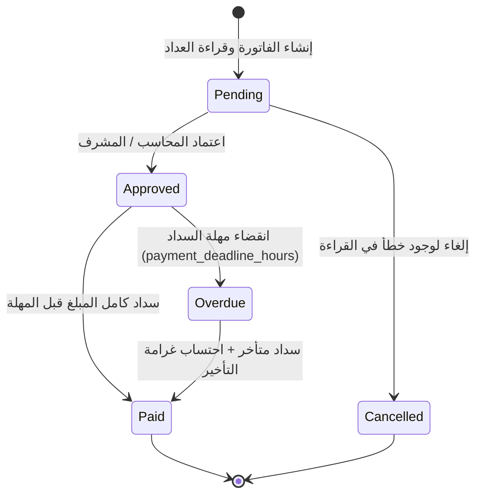
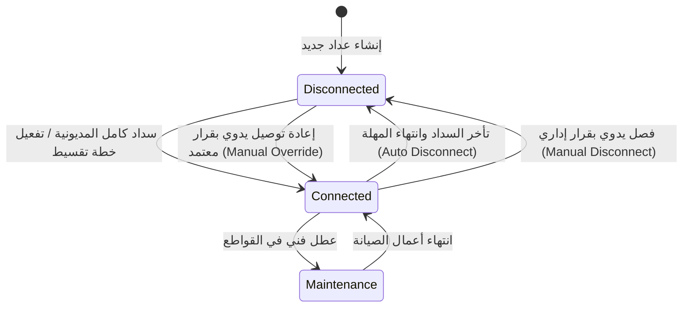

# ⚡ نظام إدارة وفوترة استهلاك الكهرباء الذكي
### Smart Electricity Billing & Automated Meter Telemetry System

<p align="center">
  
  
  
  
  
  
  
</p>

---

## 📖 نظرة عامة عن المشروع (Executive Overview)

**نظام إدارة وفوترة الكهرباء الذكي** هو منصة متكاملة على مستوى المؤسسات (Enterprise-grade) صُممت خصيصاً لإدارة شبكات استهلاك الكهرباء في المجمعات السكنية، السكنات الجامعية، والأبراج التجارية. يجمع النظام بين:
1. **التحكم والتحصيل المالي الآلي**: إصدار فواتير ذكية، احتساب الفروقات والديون المتراكمة، وربط بوابات الدفع الإلكتروني بنظام تسوية فوري ومنع الهجمات الاحتيالية (Anti-Replay).
2. **التحكم البرمجي في العدادات (Smart Telemetry & IoT Control)**: فصل وتوصيل الكهرباء آلياً للغرف عند التأخر في السداد، وإعادة التوصيل اللحظي عند السداد، مع إتاحة التحكم اليدوي المشروط بصلاحيات دقيقة وتدوين كامل للعمليات (Audit Logging).
3. **الخريطة التفاعلية للمباني (Interactive Floor Plan)**: شاشة رقمية تفاعلية توضح الحالة الكهربائية والمالية لكل غرفة بالألوان في الوقت الحقيقي.
4. **نظام تقارير وتدقيق مالي متقدم**: توليد فوري لتقارير الأداء والموازين المالية بصيغتي **PDF** مع دعم كامل للغة العربية (Cairo Font) و **Excel (.xlsx)**.

---

## 📸 معرض صور النظام (Screenshots Showcase)

<p align="center">
  <b>1. لوحة المؤشرات والإحصائيات الحية (Dashboard & Analytics)</b><br>
  
</p>

<br>

<p align="center">
  <b>2. الخريطة التفاعلية الحية للمباني والغرف (Interactive Floor Plan)</b><br>
  
</p>

<br>

<p align="center">
  <b>3. إدارة الفواتير وإجراءات السداد والاعتماد (Invoices Management)</b><br>
  
</p>

<br>

<p align="center">
  <b>4. التقارير المالية والتحليلات البيانية المتقدمة (Financial Reports & Export)</b><br>
  
</p>

<br>

<p align="center">
  <b>5. إدارة الغرف وربط العدادات الذكية والـ QR Codes</b><br>
  
</p>

<br>

<p align="center">
  <b>6. بوابة تسجيل الدخول الآمنة (Secure RBAC Authentication)</b><br>
  
</p>

---

## 🏛️ الهيكلية التقنية الشاملة للنظام (System Architecture)



---

## 🗄️ مخطط الكيانات والعلاقات (Database Entity-Relationship Diagram)



---

## 🔄 دورة حياة الفاتورة وفصل/توصيل الخدمة الآلي (Billing & Auto-Action Flows)

### 1. مخطط تتابع عملية التحصيل وإعادة التوصيل الفورية (Payment & Auto-Reconnect)



### 2. مخطط تتابع الفحص الدوري والفصل الآلي عند التعثر (Hourly Auto-Disconnect)



---

## 🚦 المخططات الحالية لحالات النظام (State Machine Diagrams)

### 1. دورة حياة الفاتورة (Invoice State Diagram)



### 2. حالات العداد الذكي (Smart Meter Connection States)



---

## 👥 مصفوفة الصلاحيات والأدوار (Role-Based Access Matrix - RBAC)

| الوظيفة / الإجراء | المشرف العام (Admin) | المحاسب (Accountant) | المندوب (Delegate) | أمين الصندوق (Cashier) |
| :--- | :---: | :---: | :---: | :---: |
| **إدارة المباني والغرف والطلاب** | ✅ كامل الصلاحية | 👁️ عرض فقط | 👁️ عرض فقط | ❌ غير متاح |
| **إدخال قراءات العدادات** | ✅ متاح | ❌ غير متاح | ✅ متاح | ❌ غير متاح |
| **اعتماد الفواتير المالية** | ✅ متاح | ✅ متاح | ❌ غير متاح | ❌ غير متاح |
| **تسجيل وتأكيد المقبوضات النقدية** | ✅ متاح | ✅ متاح | ❌ غير متاح | ✅ متاح |
| **إنشاء خطط التقسيط (Installments)** | ✅ متاح | ✅ متاح | ❌ غير متاح | ❌ غير متاح |
| **التحكم اليدوي المباشر بالعدادات** | ✅ مع توثيق السبب | ❌ غير متاح | ❌ غير متاح | ❌ غير متاح |
| **استخراج وتصدير التقارير (PDF/Excel)** | ✅ كامل الصلاحية | ✅ كامل الصلاحية | ❌ غير متاح | ❌ غير متاح |
| **تعديل الإعدادات والتعرفة (Tariff)** | ✅ متاح | ❌ غير متاح | ❌ غير متاح | ❌ غير متاح |
| **سجلات الرقابة والتدقيق (Audit Logs)**| ✅ متاح | ❌ غير متاح | ❌ غير متاح | ❌ غير متاح |

---

## 🔌 واجهات برمجة التطبيقات الأساسية (API Endpoints Overview)

| Method | Endpoint | الصلاحية المطلوبة | الوصف |
| :--- | :--- | :--- | :--- |
| `POST` | `/api/login/` | للجميع | تسجيل الدخول واستخراج JWT Access & Refresh Tokens |
| `POST` | `/api/token/refresh/` | للجميع | تجديد الـ Access Token المنتهي |
| `GET` | `/api/buildings/` | مصادق عليه | جلب قائمة المباني مع الغرف |
| `GET` | `/api/buildings/{id}/floor_plan/` | مصادق عليه | بيانات الخريطة التفاعلية للمبنى وحالات العدادات |
| `GET/POST` | `/api/invoices/` | مصادق عليه | استعراض الفواتير مع دعم الفلترة وإنشاء فواتير جديدة |
| `POST` | `/api/invoices/{id}/approve/` | Admin, Accountant | اعتماد الفاتورة لتصبح مستحقة السداد |
| `POST` | `/api/settle-payment/` | Admin, Accountant, Cashier | تسديد فاتورة أو جزء منها وفحص إعادة التوصيل |
| `POST` | `/api/verify-transaction/` | مصادق عليه | التحقق الفوري من إيصال الدفع الإلكتروني |
| `POST` | `/api/installment-plans/` | Admin, Accountant | إنشاء خطة تقسيط لجدولة المديونية |
| `POST` | `/api/manual-meter-action/` | Admin فقط | أمر فصل/توصيل يدوي مع تسجيل سبب إلزامي |
| `GET` | `/api/reports/financial/` | Admin, Accountant | توليد وتصدير التقارير المالية (JSON, PDF, Excel) |
| `GET/PATCH`| `/api/settings/` | Get: الكل / Patch: Admin | استعراض وتحديث سعر الكيلوواط والمهل الزمنية |
| `GET` | `/api/audit-logs/` | Admin فقط | استعراض سجلات التدقيق الرقابي للعمليات الحساسة |

---

## 🛠️ دليل التثبيت والتشغيل المحلي (Installation & Setup)

### 1. المتطلبات الأساسية (Prerequisites)
* **Python** (الإصدار 3.11 أو أحدث)
* **Node.js** (الإصدار 18 أو 20 أو أحدث) مع **npm**
* **PostgreSQL** (الإصدار 14 أو أحدث)

---

### 2. إعداد الخادم الخلفي (Backend Setup)

```bash
# 1. الدخول إلى مجلد المشروع وتفعيل البيئة الافتراضية
cd ElectricityBillingSystem
python -m venv venv
# لنظام Windows:
venv\Scripts\activate
# لنظام Linux/macOS:
source venv/bin/activate

# 2. تثبيت الحزم البرمجية
pip install -r backend/requirements.txt

# 3. إعداد متغيرات البيئة (أنشئ ملف backend/.env):
# DB_NAME=billing_system
# DB_USER=postgres
# DB_PASSWORD=your_password
# DB_HOST=127.0.0.1
# DB_PORT=5432
# DEBUG=True

# 4. تطبيق الترحيلات على قاعدة البيانات
python backend/manage.py migrate

# 5. تجميع الملفات الثابتة
python backend/manage.py collectstatic --noinput

# 6. تشغيل خادم التطوير
python backend/manage.py runserver 127.0.0.1:8000
```

---

### 3. إعداد لوحة التحكم (Frontend Setup)

```bash
# 1. الدخول إلى مجلد لوحة التحكم
cd admin-dashboard

# 2. تثبيت الحزم والاعتماديات
npm install

# 3. تشغيل خادم التطوير السريع (Vite)
npm run dev
```

ستفتح الواجهة على الرابط: `http://127.0.0.1:5173/`

---

## 🚀 النشر على السحابة (Cloud Deployment on Render)

المشروع مُهيأ بالكامل وجاهز للنشر المباشر عبر ملف `render.yaml` الصريح:
* **قاعدة بيانات مدارة**: PostgreSQL مجانية ومنشأة تلقائياً.
* **الخادم الخلفي (Web Service)**: يعمل ببيئة Python مع خادم `Gunicorn` و `WhiteNoise` للملفات الثابتة.
* **الواجهة الأمامية (Static Site)**: بناء آلي عبر Vite ونشر عالي السرعة مع توجيه المسارات `/* -> /index.html`.

---

## 📁 هيكلية مجلدات المشروع (Repository Structure)

```text
ElectricityBillingSystem/
├── README.md                     # التوثيق الشامل والرسمي للمشروع
├── render.yaml                   # ملف إعدادات النشر السحابي (Infrastructure as Code)
├── docs/                         # التوثيقات والوسائط
│   └── screenshots/              # لقطات شاشة موثقة للواجهات الحية
├── backend/                      # خادم Django REST Framework
│   ├── api/                      # التطبيق الرئيسي (Models, Views, Serializers, Tasks)
│   │   ├── services/             # طبقة الخدمات (Report, Meter, Payment, Audit)
│   │   ├── models.py             # نماذج قاعدة البيانات (Building, Room, Invoice, ...)
│   │   ├── views.py              # الـ ViewSets ونقاط النهاية (Endpoints)
│   │   ├── tasks.py              # المهام المجدولة (APScheduler Functions)
│   │   └── authentication.py     # مصادقة JWT المخصصة
│   ├── assets/fonts/             # الخطوط المعتمدة لتصدير الـ PDF العربي (Cairo Font)
│   ├── config/                   # إعدادات المشروع الرئيسية (settings.py, urls.py)
│   └── manage.py                 # موجه أوامر Django
└── admin-dashboard/              # واجهة المستخدم React 19 + Vite
    ├── src/
    │   ├── api/                  # عميل Axios ومعالجة تجديد التوكنات
    │   ├── components/           # المكونات (FloorPlanSection, ReportsSection, ...)
    │   ├── context/              # سياق المصادقة وصلاحيات الجلسة (AuthContext)
    │   ├── pages/                # الصفحات (DashboardPage, LoginPage, RoomPaymentPage)
    │   └── App.jsx               # موجه المسارات والتنبيهات
    ├── index.html
    └── package.json
```

---

<p align="center">
  <b>تم التطوير والتوثيق بأعلى معايير الجودة لضمان أداء مؤسسي موثوق وآمن ⚡</b>
</p>
